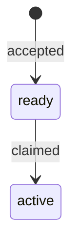

## 1. Introduction

The Focus AI publishes what it currently believes about building software, and
distributes those documents to every repository that runs an agent. Agents read
them while planning and writing tickets. This standard specifies how such a
document is written, so that a person and a parser get the same answer from it.

It follows the practice of RFC 2223 [1]: the document describing the format is
itself a document in the series, and conforms to its own rules. If this file
stops rendering, the format has drifted.

**Out of scope.** This standard does not say what the documents look like —
`DESIGN.md` covers colour, type, layout, and voice. It does not cover where
standards are published or how they are distributed to the fleet.

## 2. Requirements language

The key words **MUST**, **MUST NOT**, **SHOULD**, **SHOULD NOT** and **MAY** in
this document are to be interpreted as in RFC 2119 [2]. A clause marked
**DEPRECATED** was normative in an earlier revision and is retained so that
repositories still running it can find out what replaced it.

## 3. Requirements

### 3.1 DEPRECATED

Every standard MUST open with YAML frontmatter carrying `standard`, `title`,
`category`, `status`, `issued`, `revision`, `applies-to` and `author`.

**Obsoleted in R3 by 3.18.** The list omitted `kind`, which every other document
in the corpus carries. Provenance now has one owner — `STD-006` — and this
standard adds only what a standard needs beyond it.

`obsoletes` is optional and is present only when this document replaces another.
A field with no value is omitted rather than left empty — an empty field renders
as a fact nobody asserted.

```yaml
---
standard: "014"
title: Preview deployments on pull requests
category: Practice
status: In force
issued: "2026-07-14"
revision: R3
obsoletes: STD-009
applies-to: Web repositories
author: W. Schenk
---
```

### 3.2 DEPRECATED

The `category` field MUST be one of `Practice`, `Process` or `Guide`.

**Obsoleted in R2 by 3.17.** Listing `Guide` as a category of standard
contradicted section 4, which places guides outside `standards/`. A guide is
not a standard with a weaker category — it is a different kind of document, and
`STD-006` governs it.

A **Practice** binds repositories and is written as clauses. A **Process**
describes how the organisation works and is also written as clauses — this
document is one. A **Guide** is long-form explanation with no binding clauses:
a reference implementation walkthrough is a Guide, and forcing it into
requirement levels would damage it.

Routing and index documents are not standards and do not live in `standards/`.

### 3.3

The `status` field MUST be one of `Draft`, `In force` or `Obsoleted`.

Category and status are separate axes: a Practice can be a draft, and a Process
can be in force. Collapsing them into one field was a defect in the first cut of
`DESIGN.md` and is corrected here.

### 3.4

A standard whose category is `Practice` or `Process` MUST contain at least one
clause, and every clause MUST carry a requirement level.

The level is not written twice. It is read from the first RFC 2119 keyword in
the clause's opening sentence, which keeps one source of truth and makes a
level-less clause a rendering failure rather than a silent omission. A clause
that cannot be given a level is not a clause — it is commentary, and belongs in
a note or an introduction.

### 3.5

A clause MUST be introduced by a level-three heading containing only its number,
optionally followed by `DEPRECATED`.

The number is `<section>.<index>` and is the citable address of the requirement:
`STD-014 §3.2`. Numbers are never reused, and a deleted clause is marked
DEPRECATED rather than removed, so that a citation written last year still
resolves.

````markdown
### 3.2

The preview URL MUST be published as a check, not a comment.

Comments scroll away under review threads; checks stay pinned to the head
commit.

```sh
gh api repos/:owner/:repo/statuses/$SHA -f state=success -f context=preview
```
````

### 3.6

The first paragraph after a clause heading MUST be the normative sentence, and
it MUST state one requirement.

Everything after it is a note: reasoning, exceptions, and consequences. The
split is structural, not stylistic — the renderer sets the normative sentence
apart, and an agent extracting requirements reads first paragraphs only. Two
requirements in one clause means one of them cannot be cited.

### 3.7

A shell code block inside a clause MUST be the command that satisfies it.

This is the Actionable trait made structural: `sh`, `bash`, `zsh`, `shell` and
`console` blocks render as the runnable command, and a block in any other
language renders as an illustration rather than something the reader can run.
The distinction was found by rendering this document, which labelled its own
frontmatter example as a command — the first draft of this clause said "a fenced
code block" and was wrong. A clause with no command is permitted; a clause whose
command does not satisfy it is a defect.

### 3.8

Every standard MUST contain a section stating the requirements language and
citing RFC 2119.

This is boilerplate, and it is what earns the document the right to say MUST.
The frame is where provisionality lives; the clause does not equivocate.

### 3.9

Every standard MUST state what it does not cover.

An unstated boundary becomes someone else's wrong assumption, and an agent
planning work needs to know where a standard stops. The scope exclusion sits at
the end of the introduction, in bold.

### 3.10

A standard SHOULD cite other standards by reference, not by file path.

`STD-007 §2.1` survives a file being renamed; `@security.md` does not. The
`@file.md` form currently used across `best-practices/` is an agent-tool
convention and SHOULD be replaced during migration.

### 3.11

A revision of a standard that is `In force` MUST NOT change what an existing
clause number means.

A revision may freely change wording, add clauses, or deprecate clauses — what it
may not do is renumber, because that breaks every citation written against the
old revision. A requirement whose meaning changes gets a new number, and the old
one is marked DEPRECATED with a pointer to its replacement. A `Draft` is exempt:
nothing has cited it yet, and forcing a draft to accumulate deprecated clauses
before it is first issued would make its first revision unreadable.

### 3.12

A demonstration MUST carry the text an agent receives from raw source.

Standards are authored as markdown and may be rendered as MDX with live
components. A demonstration that only works rendered is invisible to the primary
reader, which is the agent.

### 3.13

A diagram MUST be expressed as Mermaid in a fenced `mermaid` block.

ASCII art cannot be edited without redrawing it, misaligns wherever the font is
not monospaced, and is opaque to anything that reads the document as data.
Mermaid source stays readable raw — which satisfies 3.12 without a separate
fallback — and renders as a figure for the person. A standard MUST NOT contain a
box-drawing diagram.

````markdown

````

### 3.14

A standard MUST NOT be moved from `Draft` to `In force` by an agent.

Ratification is the act of a person deciding the fleet will be bound by
something. An agent that promotes its own draft binds every repository to rules
nobody accepted, which is the same failure as `STD-002 §3.5` one level up. An
agent that believes a draft is ready says so and leaves the field alone.

### 3.15

A standard MUST render without error before it is moved to `In force`.

Rendering is the conformance check, so a standard that will not render is a
standard whose own format is broken. This is mechanical and belongs in the same
change as the status edit.

```sh
mise run standard:render
```

### 3.16

A standard that obsoletes another MUST set that standard's status to
`Obsoleted` in the same change that puts the new one `In force`.

The `obsoletes` field points forward; the status of the old document is what a
reader lands on. Leaving a superseded standard reading `In force` is the
undated-rule failure this whole corpus exists to prevent, and it is worst
exactly when someone is following the old one.

### 3.17

The `category` field MUST be either `Practice` or `Process`.

A **Practice** binds repositories; a **Process** describes how the organisation
works. Both are written as clauses and both live in `standards/`. Long-form
explanation is a guide, which is a document under `STD-006` rather than a
standard — see 3.2, obsoleted.

### 3.18

A standard MUST carry the provenance frontmatter `STD-006 §3.1` requires, plus
`standard`, `category`, `revision` and `applies-to`.

`kind: standard`, and the rest as `STD-006` defines it. One axis reads the whole
corpus: `kind` says what a document is, wherever it lives. `category`,
`revision` and `applies-to` are the fields only a standard needs — what it
binds, which cut it is, and who it binds.

```yaml
---
standard: "014"
kind: standard
title: Preview deployments on pull requests
category: Practice
status: In force
issued: "2026-07-14"
revision: R3
obsoletes: STD-009
applies-to: Web repositories
author: W. Schenk
---
```

## 4. File layout

Standards live in `standards/`, one file per document, named
`STD-<number>-<slug>.md`.

Guides live in `best-practices/` and are **not** standards. They are documents
under `STD-006` with `kind: guide`, carrying explanation, walkthroughs, and
reference implementations. When a guide turns out to contain rules, the rules
move to a standard and the guide keeps the explanation — that migration is what
produced `STD-007` through `STD-011`.

Render and check conformance with:

```sh
mise run standard:render
```

The renderer refuses to emit a page for a document that does not satisfy this
standard. Conformance is not a separate audit — if it renders, it conforms.

Guides, research notes, decision records, prompts and skills render alongside
the standards, checked against `STD-006` rather than against this document, and
are published subordinate to them: no clauses, a memo stating what the document
is and what it does not do, and a link in both directions between it and the
standards it names. A document that names no standard says so on its own page,
which is how an undecided area becomes visible instead of quiet.

## 5. References

[1] Postel, J. and Reynolds, J., *Instructions to RFC Authors*, RFC 2223,
October 1997.

[2] Bradner, S., *Key words for use in RFCs to Indicate Requirement Levels*,
BCP 14, RFC 2119, March 1997.

[3] The Focus AI, `DESIGN.md` — visual language and voice for the standards
corpus. In force.
