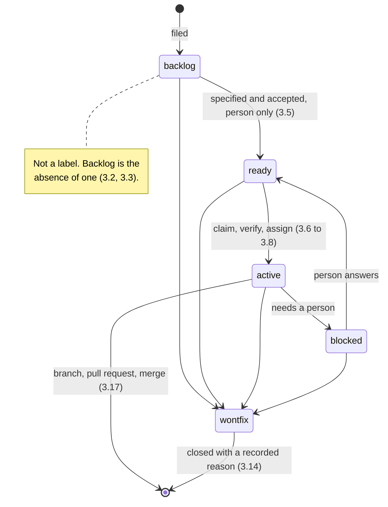

## 1. Introduction

Agents pick up work from the issue tracker without a person in the loop. That
only works if the tracker states, unambiguously and at a glance, what is
specified, what is being worked, and what is stuck. This standard fixes the
state vocabulary, who may move an issue between states, and what an agent says
when it does.

It replaces the per-project `docs/agents/issue-workflow.md` template, which is
deleted. Twenty editable copies of a rule are twenty rules, and a bootstrap
script that seeded a fresh copy into every new repository guaranteed the drift.
Configuration a repository genuinely varies — which tracker it uses, where its
local fallback lives — belongs in that repository's `AGENTS.md`, as
configuration rather than as a restatement of the vocabulary.

**Out of scope.** Pull requests, branch naming, and review are `STD-003`. This
standard does not cover which planning skills produce a ticket, nor the contents
of a spec beyond where it lives.

## 2. Requirements language

The key words **MUST**, **MUST NOT**, **SHOULD**, **SHOULD NOT** and **MAY** in
this document are to be interpreted as in RFC 2119 [1]. A clause marked
**DEPRECATED** was normative in an earlier revision and is retained so that
repositories still running it can find out what replaced it.

## 3. Requirements

### 3.1

An open issue MUST carry at most one state label from `ready`, `active`,
`blocked`, `wontfix`.

At most one, never two. An issue holding two states is a question nobody can
answer. State is a single axis, and a tracker where that is not enforced stops
being a source of truth within a week.

### 3.2

An issue with no state label MUST be treated as backlog.

Backlog is the absence of a state, not a label. A newly filed issue is in the
backlog because nobody has said otherwise, which means filing costs one action
instead of two and nothing has to be labelled to be captured. Demoting an issue
is removing its label, not swapping one.

### 3.3

A `backlog` label MUST NOT be applied.

Two representations of one state is the same defect as two components reporting
one truth. If the label existed, an unlabelled issue and a `backlog`-labelled
issue would be indistinguishable in meaning and distinguishable on a board,
which is how a tracker starts lying.

### 3.4

An issue MUST NOT be labelled `ready` unless it states a goal, background links,
acceptance criteria, a verification plan, and what is out of scope.

`ready` is a promise that an agent can complete the work without asking anyone
anything. Those five sections are what make that promise checkable. An issue
missing any of them is `backlog`, however obvious the work seems.

### 3.5

An agent MUST NOT move an issue into `ready`.

This is the triage gate, and it is the one place a person is structurally
required. Without it an agent can declare its own underspecified ticket ready
and then pick it up, which converts a planning failure into merged code. An
agent that believes an issue is ready says so in a comment and leaves the label
alone.

### 3.6

An agent MUST assign itself to an issue before labelling it `active`.

`active` answers "is anyone on this"; the assignee answers "who". Both are
needed when several sessions share a frontier, and an `active` issue with no
assignee is indistinguishable from an abandoned one.

### 3.7

An agent MUST re-read an issue immediately before claiming it, and MUST
abandon the claim if the issue is no longer on the frontier.

Several agents read the same frontier at the same time. Whatever an agent
learned when it listed the frontier is already stale by the time it acts, so the
check happens against the tracker at the moment of claiming — not against the
listing. If the issue has gained an assignee, changed state, or closed, the
agent takes the next item instead. Two agents on one ticket is two branches, two
pull requests, and a merge conflict nobody planned.

```sh
gh issue view "$N" --json assignees,state,labels \
  | jq -e '.assignees == [] and .state == "OPEN"' || exit 0
gh issue edit "$N" --add-assignee "@me" --add-label active
gh issue view "$N" --json assignees \
  | jq -e '[.assignees[].login] == ["'"$AGENT"'"]' || exit 0
```

### 3.8

An agent MUST verify it holds the claim after making it, and MUST yield if it
does not.

Assignment is not atomic on any tracker this fleet uses. Read back after
writing: if the agent is not the sole assignee, another session won the race and
this one stops, without commenting and without unassigning the winner.

### 3.9

`blocked` MUST mean the issue is waiting on a person.

A question, a decision, an access grant, an external dependency. It is a human
queue, and it is meant to be worked. Blocking on *another issue* is not this —
see 3.10. Conflating the two is why boards stop being trusted: a `blocked` column
full of items that will unblock themselves teaches everyone to ignore it.

### 3.10

A dependency between issues MUST be recorded as a blocking relationship, never
as a label.

Use the tracker's native blocked-by relationship where it exists, and a
`## Blocked by` section listing issue references where it does not. The
dependency then resolves itself when the blocker closes, with nobody
relabelling anything.

### 3.11

An agent MUST take work only from the frontier.

The frontier is every issue that is `ready`, unassigned, and has no open
blocking relationship. An agent that reaches outside it is either working
something a person has not accepted, something already claimed, or something
whose prerequisites do not exist yet.

### 3.12

An agent MUST comment on the issue whenever it changes that issue's state.

The label says what the state is; the comment says why it changed. A state
change with no comment leaves the next reader — usually another agent —
guessing at intent from a timestamp.

### 3.13

A state-change comment MUST state what happened and what happens next.

One or two sentences. No preamble, no apology, no restating the ticket title.
"Blocked: the preview vault has no `NEON_URL` for this project. Needs an
operator to create it, then this returns to `ready`." Voice follows `DESIGN.md`
— factual, no enthusiasm, no emoji.

### 3.14

An issue labelled `wontfix` MUST carry the reason in a comment before it is
closed.

`wontfix` is a decision, and a decision with no recorded reason gets relitigated
every quarter. Name what was decided and what would change the answer.

### 3.15

A spec or PRD MUST exist as its own tracker item, and every ticket derived from
it MUST link back to that item.

Specs live where the work lives, so an agent reading a ticket can reach the
reasoning behind it in one hop. The spec item carries a type label and moves
through the same states; it is excluded from the frontier by 3.16 rather than by
being kept somewhere else.

### 3.16

An issue that is not directly workable MUST carry a type label, and an agent
MUST NOT take type-labelled planning items as work.

Type is a second axis, independent of state: `type:spec`, `type:epic`, and the
existing `wayfinder:map` are containers, not tickets. They may be `ready` —
meaning ready to be broken down — without being something to implement.

### 3.17

Work on an `active` issue MUST be delivered as a branch and a pull request that
reference the issue.

The chain is issue → branch → pull request → merge, and every link names the one
before it. An issue whose work landed without a pull request has no reviewable
record of what changed; a branch that names no issue cannot be traced back to
the requirement it satisfies. Naming and the shape of the pull request are
`STD-003`.

### 3.18

An issue MUST NOT be closed by an agent before its pull request merges.

Merging closes the issue, and nothing else does. An agent that closes on
"finished writing the code" closes work that has not shipped, which is the one
tracker lie that costs a release.

### 3.19

An issue SHOULD NOT be created for work already described by an open issue.

At the volume this fleet generates, duplicates are the main way a tracker
becomes unusable. Search before filing; when work turns out to be a duplicate,
close it referencing the original rather than merging the two descriptions.

## 4. The state machine



Backlog is drawn dashed because it is not a label — it is what an issue is when
no state label is present (3.2). Closing is not a label either: an issue that is
done is closed by its pull request merging, with its state label left as it was.
`wontfix` is the only state that describes *why* something closed.

## 5. Label reference

| Label | Axis | Meaning | Who sets it |
| --- | --- | --- | --- |
| *(none)* | state | Backlog — captured, not yet specified or accepted | Default |
| `ready` | state | Fully specified; an agent can finish it unaided | Person only |
| `active` | state | An agent is working it; assignee names which | Agent |
| `blocked` | state | Waiting on a person | Agent or person |
| `wontfix` | state | Decided against; reason recorded | Person |
| `type:spec` | type | A spec or PRD, not a ticket | Anyone |
| `type:epic` | type | A container for tickets | Anyone |
| `wayfinder:*` | type | Wayfinder map and child-ticket kinds | Wayfinder |

Migrating from the previous vocabulary: `ready-for-agent` becomes `ready`,
`needs-triage` is deleted (an unlabelled issue is already backlog), and
`needs-info` becomes `blocked`.

## 6. References

[1] Bradner, S., *Key words for use in RFCs to Indicate Requirement Levels*,
BCP 14, RFC 2119, March 1997.

[2] The Focus AI, `STD-001` — How a standard is written. In force.

[3] The Focus AI, `STD-003` — Pull requests and branches. Draft.
