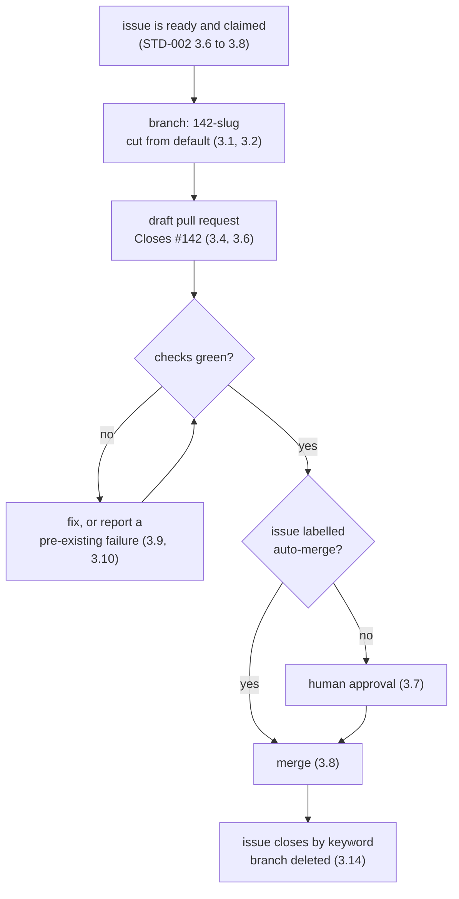

## 1. Introduction

`STD-002` requires that work on an issue arrive as a branch and a pull request.
This standard specifies their shape: how a branch is named, how a pull request
links back to the issue that justified it, what an agent says on it, and who is
allowed to merge.

The chain is issue → branch → pull request → merge, and each link names the one
before it. A repository worked by several agents at once has no other way to
answer "why does this code exist" six months later.

**Out of scope.** Issue states, claiming, and the frontier are `STD-002`. This
standard does not specify what CI runs, only how its result gates a merge, and
it does not cover release or deployment.

## 2. Requirements language

The key words **MUST**, **MUST NOT**, **SHOULD**, **SHOULD NOT** and **MAY** in
this document are to be interpreted as in RFC 2119 [1]. A clause marked
**DEPRECATED** was normative in an earlier revision and is retained so that
repositories still running it can find out what replaced it.

## 3. Requirements

### 3.1

A branch MUST be named `<issue-number>-<slug>`.

The number comes first so the issue is derivable from the branch with no
metadata, no lookup table, and no naming convention to remember: `142-preview-
check-not-comment`. The slug is lowercase, hyphenated, and describes the change
rather than the ticket. Branches sort by issue as a side effect.

```sh
gh issue view "$N" --json title \
  | jq -r '"'"$N"'-" + (.title | ascii_downcase | gsub("[^a-z0-9]+"; "-"))'
```

### 3.2

A branch MUST be cut from the default branch at the moment work starts.

Not from another feature branch, and not from a stale local copy. An agent
working from yesterday's base produces a diff that reviews against code nobody
is running.

### 3.3

An agent MUST open exactly one pull request per issue.

One issue, one branch, one pull request. Work that will not fit in one pull
request is an issue that should have been split, and splitting it is cheaper
before the code exists than after. This keeps the chain traceable in both
directions without a join table.

### 3.4

A pull request MUST reference its issue with a closing keyword in the
description.

`Closes #142`. The keyword is what makes merging close the issue, which is the
mechanism `STD-002 §3.18` depends on — an agent never closes an issue by hand.
A pull request with no linked issue is work nobody accepted.

### 3.5

A pull request description MUST state what changed and why, in the standard's
voice.

Not a diff summary — the diff is already there. Name the behaviour that is
different now and the requirement it satisfies. Follow `DESIGN.md`: factual, no
enthusiasm, no emoji, no restating the ticket title.

### 3.6

A pull request that is not ready for review MUST be opened as a draft.

Opening early is encouraged: it publishes intent, gives CI somewhere to run, and
lets another agent see the work exists before duplicating it. Draft status is
how that happens without requesting attention nobody has time to give.

### 3.7

An agent MUST NOT merge a pull request it authored.

Two gates bound the autonomous stretch: a person accepts the work by labelling
the issue `ready`, and a person accepts the result by approving the pull
request. Everything between them is unattended. An agent that merges its own
work removes the second gate and leaves the fleet grading its own homework.

### 3.8

A pull request MAY merge without human approval when its issue carries the
`auto-merge` label and every required check passes.

The label is set by a person at triage, on the issue, before the work starts —
so the decision to let a change land unattended is made by a human who has read
the requirement, not by the agent that wrote the code. Without it, 3.7 stands.

### 3.9

An agent MUST NOT merge a pull request with a failing required check.

A red check is a statement that the change does not work. Overriding it converts
a broken build into a broken main branch, and every agent that branches
afterwards inherits it.

### 3.10

An agent MUST establish whether a failing check also fails on the default
branch, and MUST say which in the pull request.

A pre-existing failure is not this change's defect and must not be silently
fixed inside an unrelated pull request; it also must not be used to wave the
change through. Say which it is, once, and act accordingly.

### 3.11

An agent MUST NOT force-push a branch after a human has reviewed it.

Force-pushing discards the commits a reviewer read and invalidates approvals
without saying so. Before review, rewriting history freely is fine and often
tidier; after it, append.

### 3.12

An agent MUST comment on the pull request when it changes the work in response
to review.

Say what changed and where. A silent push after a review comment leaves the
reviewer re-reading the whole diff to find out whether they were heard.

### 3.13

An agent SHOULD NOT comment on a pull request to narrate routine progress.

Pushing a commit is already visible. Comment when something needs a decision,
when a review is answered, when a check fails for a reason outside the change,
or when the agent stops. Everything else is noise in a thread a person has to
read.

### 3.14

A merged branch MUST be deleted.

The pull request retains the history. A repository worked by many agents
accumulates dead branches faster than anyone prunes them, and a stale branch is
an invitation to cut new work from the wrong base.

### 3.15

A pull request that supersedes another MUST say so, and the superseded one MUST
be closed.

Two open pull requests against one issue is the state `3.3` exists to prevent;
when it happens anyway — usually a lost claim race under `STD-002 §3.8` — the
loser closes with a reference to the winner rather than lingering.

### 3.16

An agent that abandons work MUST return the issue to the frontier.

Close the pull request or leave it draft, remove the `active` label, unassign
itself, and comment saying what was learned and what is left. Work an agent
walked away from silently is work that looks claimed forever.

## 4. The lifecycle



## 5. References

[1] Bradner, S., *Key words for use in RFCs to Indicate Requirement Levels*,
BCP 14, RFC 2119, March 1997.

[2] The Focus AI, `STD-001` — How a standard is written. In force.

[3] The Focus AI, `STD-002` — Issues and agent workflow. Draft.
