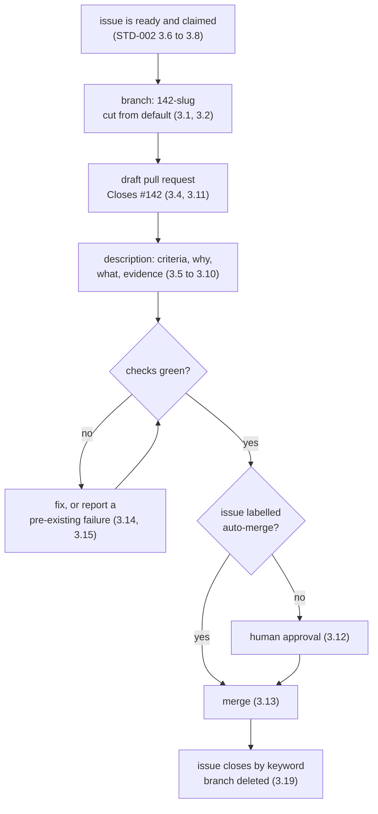

## 1. Introduction

`STD-002` requires that work on an issue arrive as a branch and a pull request.
This standard specifies their shape: how a branch is named, how a pull request
links back to the issue that justified it, what its description must contain and
prove, what an agent says on it, and who is allowed to merge.

The chain is issue → branch → pull request → merge, and each link names the one
before it. A repository worked by several agents at once has no other way to
answer "why does this code exist" six months later.

**Out of scope.** Issue states, claiming, and the frontier are `STD-002`. This
standard does not specify what CI runs, only how its result gates a merge, and
it does not cover release or deployment.

## 2. Requirements language

The key words **MUST**, **MUST NOT**, **SHOULD**, **SHOULD NOT** and **MAY** in
this document are to be interpreted as in RFC 2119 [1]. A clause marked
**DEPRECATED** was normative in an earlier revision and is retained so that
repositories still running it can find out what replaced it.

## 3. Requirements

### 3.1

A branch MUST be named `<issue-number>-<slug>`.

The number comes first so the issue is derivable from the branch with no
metadata, no lookup table, and no naming convention to remember:
`142-preview-check-not-comment`. The slug is lowercase, hyphenated, and
describes the change rather than the ticket. Branches sort by issue as a side
effect.

```sh
gh issue view "$N" --json title \
  | jq -r '"'"$N"'-" + (.title | ascii_downcase | gsub("[^a-z0-9]+"; "-"))'
```

### 3.2

A branch MUST be cut from the default branch at the moment work starts.

Not from another feature branch, and not from a stale local copy. An agent
working from yesterday's base produces a diff that reviews against code nobody
is running.

### 3.3

An agent implementing an issue MUST open exactly one pull request for that issue.

One issue, one branch, one pull request. Work that will not fit in one pull
request is an issue that should have been split, and splitting it is cheaper
before the code exists than after. This keeps the chain traceable in both
directions without a join table. Tracker-only duplicate closure under
`STD-002 §3.18` does not require an implementation pull request.

### 3.4

A pull request MUST reference its issue with a closing keyword in the
description.

`Closes #142`. The keyword is what makes merging close the issue, which is the
completion mechanism `STD-002 §3.18` depends on. Closing a linked duplicate under
that clause is tracker cleanup, not completion of the original issue's work.
A pull request with no linked issue is work nobody accepted.

### 3.5

A pull request description MUST carry the sections in section 4, in that order.

Success criteria, why, what changed, evidence. The order is the requirement, not
a suggestion: a reviewer opening the page reads what "working" means before
reading anything else, and can then judge everything below against it.

### 3.6

Success criteria MUST be the first content in the description.

Above the why, above the diff summary, above everything. A reviewer who has to
scroll to find out what the change is supposed to achieve will review the code
they were shown instead of the outcome that was wanted — and an agent that
writes the criteria first has to decide what done means before it starts.

### 3.7

Every success criterion MUST be a statement someone else can check.

"A reviewer can open the preview URL from the check list" is checkable. "Preview
deployments work properly" is not. Write each one so that a person who did not
do the work, and did not read the diff, can determine whether it holds.

### 3.8

A pull request for a feature build MUST evidence every success criterion.

A feature build is any change to behaviour a person can observe. Each criterion
names the artefact that proves it: a screenshot, a recording, command output, or
a test name. An unevidenced criterion is an assertion, and the reviewer is the
one who ends up testing it by hand.

### 3.9

A pull request that changes a visible surface MUST include a screenshot of that
surface after the change.

Prose describing a layout is not reviewable. Where the change alters something
that already existed, show before and after. A reviewer should not have to run
the branch to find out what it looks like — that is what the preview deployment
and the screenshot are both for.

### 3.10

A pull request that changes an interaction or a multi-step flow SHOULD include a
recording.

A screenshot cannot show a transition, a loading state, an error path, or the
order in which things happen. Where those are the change, record the flow. Keep
it short and unnarrated; the point is evidence, not a demo.

### 3.11

A pull request that is not ready for review MUST be opened as a draft.

Opening early is encouraged: it publishes intent, gives CI somewhere to run, and
lets another agent see the work exists before duplicating it. Draft status is
how that happens without requesting attention nobody has time to give.

### 3.12

An agent MUST NOT merge a pull request it authored.

A person or agent can establish ticket readiness under `STD-002 §3.5`; that does
not remove the independent merge gate. A person accepts the result by approving
the pull request, except for the explicit prior delegation in §3.13. Marking a
ticket `ready` is not permission to approve one's own result.

### 3.13

A pull request MAY merge without human approval when its issue carries the
`auto-merge` label and every required check passes.

The label is set by a person at triage, on the issue, before the work starts —
so the decision to let a change land unattended is made by a human who has read
the requirement, not by the agent that wrote the code. Without it, 3.12 stands.

### 3.14

An agent MUST NOT merge a pull request with a failing required check.

A red check is a statement that the change does not work. Overriding it converts
a broken build into a broken main branch, and every agent that branches
afterwards inherits it.

### 3.15

An agent MUST establish whether a failing check also fails on the default
branch, and MUST say which in the pull request.

A pre-existing failure is not this change's defect and must not be silently
fixed inside an unrelated pull request; it also must not be used to wave the
change through. Say which it is, once, and act accordingly.

### 3.16

An agent MUST NOT force-push a branch after a human has reviewed it.

Force-pushing discards the commits a reviewer read and invalidates approvals
without saying so. Before review, rewriting history freely is fine and often
tidier; after it, append.

### 3.17

An agent MUST comment on the pull request when it changes the work in response
to review.

Say what changed and where. A silent push after a review comment leaves the
reviewer re-reading the whole diff to find out whether they were heard.

### 3.18

An agent SHOULD NOT comment on a pull request to narrate routine progress.

Pushing a commit is already visible. Comment when something needs a decision,
when a review is answered, when a check fails for a reason outside the change,
or when the agent stops. Everything else is noise in a thread a person has to
read.

### 3.19

A merged branch MUST be deleted.

The pull request retains the history. A repository worked by many agents
accumulates dead branches faster than anyone prunes them, and a stale branch is
an invitation to cut new work from the wrong base.

### 3.20

A pull request that supersedes another MUST say so, and the superseded one MUST
be closed.

Two open pull requests against one issue is the state 3.3 exists to prevent;
when it happens anyway — usually a lost claim race under `STD-002 §3.8` — the
loser closes with a reference to the winner rather than lingering.

### 3.21

An agent that abandons work MUST release its claim and record the issue's
resulting state.

Close the pull request or leave it draft, unassign itself, and replace `active`
with `ready` if the ticket remains actionable under `STD-002 §3.4–3.5`. Use
`blocked` when a person must answer; remove the state label for backlog when
the specification needs more work. Comment saying what was learned and what is
left. Releasing a claim does not make an unresolved decision disappear.

## 4. The description

Four sections, in this order. A change that is not a feature build — a refactor,
a dependency bump, a docs fix — still carries success criteria and why, and may
reduce evidence to the check that proves it.

````markdown
## Success criteria

- [ ] A reviewer can reach the preview from the pull request check list
- [ ] The preview serves this branch's build, not the default branch's
- [ ] Preview uses the documented runtime-key mapping and cannot write the production database
- [ ] The preview is gone within an hour of merge

## Why

Closes #142. Reviews were being approved without anyone opening the change,
because the only preview link was a comment that scrolled away under the
review thread.

## What changed

The preview URL is now published as a commit status rather than a comment,
so it stays pinned to the head commit and appears in the check list. Runtime
keys follow the documented mapping; database writes target the preview branch.

## Evidence

| Criterion | Evidence |
| --- | --- |
| Preview reachable from checks |  |
| Serves this branch's build |  |
| Runtime mapping and database protection | Key-name inventory and database-target test output below; no secret values |
| Torn down after merge | [recording](https://…/teardown.mp4) |
````

Evidence lives in the pull request, not in a link that expires. Attach images
and recordings to the pull request itself rather than referencing a temporary
build artefact or a chat message.

## 5. The lifecycle



## 6. References

[1] Bradner, S., *Key words for use in RFCs to Indicate Requirement Levels*,
BCP 14, RFC 2119, March 1997.

[2] The Focus AI, `STD-001` — How a standard is written. In force.

[3] The Focus AI, `STD-002` — Issues and agent workflow. Draft.
