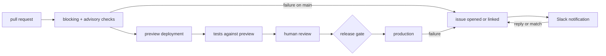

## 1. Introduction

`STD-004` requires a `test` task and `STD-008` says how a deployment is
targeted, but nothing joins the two. It is unstated when tests run, which
results may block a merge, how a preview is shown to work before a person
reviews it, or what happens when something fails after nobody is watching.
The fleet answers each of those differently in every repository, and an
answer that has to be rediscovered is an answer agents get wrong.

This standard covers the loop from pull request to production and back:
checks run on every pull request and are classified as blocking or advisory,
previews are verified rather than assumed, data and model behaviour are held
to recorded benchmarks, production is reached through named gates, and a
failure becomes an issue, a notification, and a conversation routed back to
that issue.

The loop it specifies:



**Out of scope.** Which test runner or framework a repository uses (`STD-004`).
The shape of a pull request and who merges it (`STD-003`). Platform mechanics
for Vercel and GCP (`best-practices/GDE-010-vercel-deployment.md`,
`best-practices/GDE-005-gcp-deployment.md`). The walkthrough, templates and a
worked example are in `best-practices/GDE-014-testing-and-preview-pipeline.md`.

## 2. Requirements language

The key words **MUST**, **MUST NOT**, **SHOULD**, **SHOULD NOT** and **MAY** in
this document are to be interpreted as in RFC 2119 [1]. A clause marked
**DEPRECATED** was normative in an earlier revision and is retained so that
repositories still running it can find out what replaced it.

## 3. Requirements

### 3.1

A repository with a `test` task MUST run `mise run lint` and `mise run test` in
CI on every pull request and on every push to the default branch.

A test that only runs on a laptop is a test that runs when someone remembers.
Running the same `mise` tasks a developer runs keeps CI and local results
answering the same question.

### 3.2

Every check MUST be classified as blocking or advisory, and the classification
MUST be recorded in `docs/testing.md`.

A blocking check means the change is wrong and must not proceed: a failed
build, a broken schema, a missing input. An advisory check means somebody
should look: a variance, an unknown column, a slower benchmark. Leaving the
class implicit makes every red mark negotiable, and the fleet learns to ignore
all of them.

### 3.3

Only blocking checks MUST be marked as required in branch protection.

`STD-003 §3.14` forbids merging over a failing required check, so the
required set is the blocking set. An advisory check made required turns a
judgement into a gate; a blocking check left optional turns a gate into a
suggestion.

### 3.4

A test that CI runs MUST NOT require secrets, data or services that exist only
on a developer's machine.

Use a disposable service in the job (a Postgres service container, a local
emulator), fixtures committed to the repository, or appropriately scoped credentials
from fnox under `STD-007`. A test that needs a laptop to pass will be skipped
by the first agent that cannot reach one.

### 3.5

A web repository MUST produce a preview deployment for every pull request, or
state that its platform cannot, per `STD-008 §3.8`.

The preview is what a reviewer clicks instead of checking out the branch, and
what the tests in 3.7 run against.

### 3.6

The preview URL MUST be published as a commit status or check on the head
commit, not only as a comment.

Comments scroll away under review threads and do not move with new commits.
A status (`context=preview` or `context=preview/e2e`) with `target_url` set to
the preview origin is pinned to the commit it describes, so an agent can resolve
it deterministically without parsing prose:

```sh
gh api "repos/:owner/:repo/commits/$SHA/status" \
  --jq '.statuses[] | select(.context == "preview/e2e") | .target_url'
```

### 3.7

A pull request that changes a deployed surface MUST have smoke or end-to-end
verification of its release candidate before it is marked ready for review.

Run against the preview when the platform provides one. If the documented
platform limitation in §3.5 prevents that, exercise the production build/start
path in the reproducible cloud workspace and record the deployment behavior
that remains unverified. Neither a unit suite nor a laptop-only run substitutes
for this check. The run's result is evidence under `STD-003 §3.8`.

### 3.8

A preview MUST follow the environment and credential rules in `STD-007`.

That standard owns production parity, justified differences, scoped runtime
keys, and protection from preview writes to the production database. There is
no second, testing-specific requirement for separate vaults or provider accounts.

### 3.9

A repository whose output is data or model behaviour MUST keep a regression
benchmark, and a result below the recorded baseline MUST be a blocking check.

Matchers, extractors, classifiers and agents regress silently: the code still
runs and the numbers get worse. The benchmark runner MUST record the dataset
identifier, metric name, committed baseline score, measured score, and commit
SHA, and exit non-zero whenever the measured score falls below the baseline.

### 3.10

A confidence threshold that lets output be accepted without human review MUST
be recorded in `docs/testing.md` with its benchmark evidence and approved by a
person.

"Auto-accept above 80%" is a policy decision dressed as a constant. Record the
metric, the numeric bands (auto-accept, human review queue, and
insufficient-evidence), the benchmark run that justified them, and who approved
them with the date, so that a change to the number gets the same review as a
change to the code.

### 3.11

A production release MUST pass its recorded sign-off gate before deployment.

No separate staging environment is required. Verify the release candidate in
preview (or the documented §3.7 alternative), record the evidence and required
approval, then deploy that candidate through CI. A gate names what must be true
and who decides; an agent reports evidence but cannot supply a required person's
approval. The gate follows the project's recorded maturity under §3.20–3.21;
a maturity value does not itself grant merge or deployment authority.

### 3.12

A failing blocking check on the default branch, a failed production deployment,
or a failed scheduled check MUST open an issue or link to the open issue that
already describes it.

A failure nobody owns does not get fixed. Opening an issue puts it in the
backlog until readiness is assessed under `STD-002`; linking keeps one failure from
becoming twenty duplicates, which `STD-002 §3.19` already asks for.

### 3.13

Automated issues MUST be deduplicated on a stable fingerprint recorded in the
issue body as `<!-- fp:<scope>:<target>:<rule> -->`.

`<scope>` is `ci`, `deploy` or `qa`; `<target>` is the workflow or feed; `<rule>`
is the job or check name (for example `<!-- fp:ci:ci.yml:check -->` or
`<!-- fp:qa:samsung:l1-arrival -->`), never a timestamp or run ID. Before
creating an issue, automation searches open issues for that exact marker and
comments on the match if one exists.

### 3.14

An automated issue MUST carry what failed, where, the first and latest
occurrence, a link to the run or log, and whether the check is blocking or
advisory.

An issue that says "CI failed" sends the reader back to find out everything
the automation already knew.

### 3.15

An automated issue MUST satisfy `STD-002 §3.4–3.5` before being labelled `ready`.

A raw failure report usually lacks a goal, scope, or verification plan and stays
in backlog. A person or agent can complete those and assess readiness; neither
the `automated` label nor a failing check makes a ticket ready by itself. Apply
`automated` (and `bug` where applicable) to describe origin and kind, not state.

### 3.16

A failure that opens or updates an issue MUST notify the repository's named
Slack channel, linking the issue.

The issue is the record; Slack is how a person finds out. The channel is
named in `docs/testing.md` (see 3.19), not hard-coded in a workflow, so
moving it is one edit.

### 3.17

A notification MUST link the issue it is about, and repeat failures MUST be
threaded under the first notification rather than posted again.

The first post records `<!-- slack:channel=<channel-id>;ts=<thread_ts> -->` on
the issue. Subsequent failures for the same issue read `ts` from that marker and
post with `thread_ts` set. One thread per issue keeps the channel readable and
gives replies a single place to land.

### 3.18

A reply to a notification, or a match that resolves it, MUST be routed back to
the issue as a comment.

People answer in Slack, and an answer that stays in Slack is lost to the next
agent reading the issue. A human reply in the Slack thread becomes an issue
comment attributed to its author; a resolving match — a later passing run of the
same `fp:…` fingerprint, a fix PR, or a recovered feed — posts a comment carrying
`<!-- resolved-by:<url-or-sha> -->` and mirrors that update to the Slack thread.
Issue closure follows `STD-002 §3.18`, including its linked-duplicate exception.
A recovery notification alone does not authorize an agent to close the original.

### 3.19

A repository MUST record its check classification, preview verification,
benchmarks and thresholds, sign-off gates, and Slack channel in
`docs/testing.md`.

`docs/testing.md` MUST contain five level-two sections — `## Checks`,
`## Preview verification`, `## Benchmarks and thresholds`, `## Sign-off gates`,
and `## Alerting` (marking `N/A` where a section does not apply) — so that an
agent scaffolding workflows and a person approving a release read and validate
the same file.

### 3.20

A repository MUST record its owner-approved product maturity as `alpha`,
`client-testing`, or `production` in `AGENTS.md`.

Record the owner, approval date, and rationale alongside the value, including
when it changes. An agent may recommend a classification and collect evidence;
a person approves it. Missing or unassessed maturity is a gap, not an implicit
`alpha` classification.

Maturity describes who relies on the product, not its deployment topology or
the existence of a production URL. It is not a ticket label: `ready` still means
actionable at every maturity (`STD-002 §5`).

### 3.21

A release gate MUST apply the verification and approval profile for the
project's recorded maturity.

| Maturity | Who relies on it | Verification before release | Release gate |
| --- | --- | --- | --- |
| `alpha` | Internal exploration; no client operational dependency | Lint/test and smoke-test the changed workflow in a cloud preview; record known gaps. | Project owner may explicitly delegate bounded, reversible releases. No delegation is inferred from this label. |
| `client-testing` | A named client is evaluating representative workflows | Alpha checks plus client acceptance scenarios, representative data, and clear known limitations. | Named owner accepts client-visible changes; record client acceptance where the agreed test plan requires it. |
| `production` | People depend on the product for real work | Regression checks plus relevant auth, client-isolation, data, and migration checks; verified release candidate and rollback path. | Explicit release approval under the recorded gate, with an operational owner and recovery plan. |

Record the actual checks, approver, evidence links, and any bounded delegation
in `docs/testing.md`, referring to the maturity in `AGENTS.md` rather than
maintaining a second value. Delegation names the permitted actions and limits;
it does not waive the merge gates in `STD-003`.

These profiles add to the applicable requirements; they do not relax security
or grant authority for external actions. Cloud-first development (`STD-005`),
production-like previews and data protection (`STD-007`), and client-specific
OAuth (`STD-009`) apply at every maturity. The §3.7 cloud verification alternative
applies where previews are unavailable; no separate staging is required.

## 4. References

[1] Bradner, S., *Key words for use in RFCs to Indicate Requirement Levels*,
BCP 14, RFC 2119, March 1997.

[2] The Focus AI, `STD-002` — Issues and agent workflow. Draft.

[3] The Focus AI, `STD-003` — Pull requests and branches. Draft.

[4] The Focus AI, `STD-004` — Repository tooling and tasks. Draft.

[5] The Focus AI, `STD-007` — Secrets and credentials. Draft.

[6] The Focus AI, `STD-008` — Deployment. Draft.

[7] The Focus AI, `best-practices/GDE-014-testing-and-preview-pipeline.md` —
Testing and preview pipeline.
